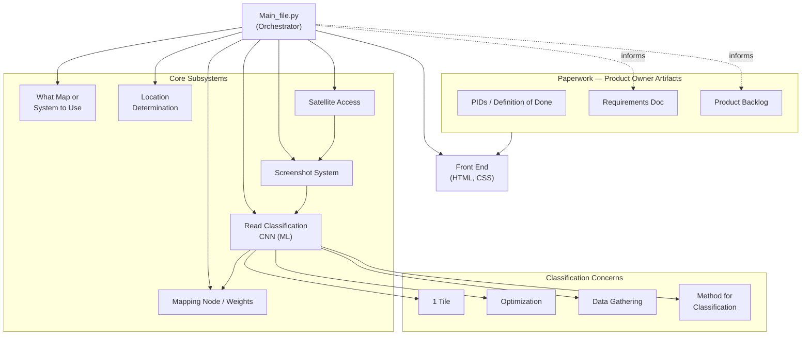

# Navi-Gator — Project Hierarchy

A digitized version of the hand-drawn project hierarchy for the Navi-Gator map GPS
web-based application. The diagrams below render automatically on GitHub.

The application computes routes that account for **real road/terrain conditions**:
it pulls satellite imagery for candidate paths, screenshots them, classifies each
segment with a CNN (ML) model, converts that classification into an **edge weight**
in a routing graph, and recalculates the shortest path from those weights.

---

## 1. System Hierarchy

How the pieces of the project relate. `Main_file.py` is the orchestrator that calls
each subsystem. The **Paperwork** branch is owned by the Product Owner and feeds the
build.

---

## 2. Runtime Pipeline

The end-to-end flow when a user requests a route.

---

## 3. Notes & Constraints

- **Map tile source:** MapBox — **700,000 free tiles per month**. This is a real
  budget constraint worth tracking (screenshotting at regular intervals along many
  candidate paths consumes tiles quickly).
- **Orchestrator:** `Main_file.py` coordinates location, satellite access,
  screenshot capture, classification, and graph/weight updates, then hands the final
  path to the front end.
- **ML classification** (CNN) turns a satellite screenshot of a road segment into a
  weight that biases routing away from poor-quality roads.

---

*This document is a digitized reference of the team's hand-drawn hierarchy. Edit the
Mermaid blocks above to keep it in sync as the architecture evolves.*
